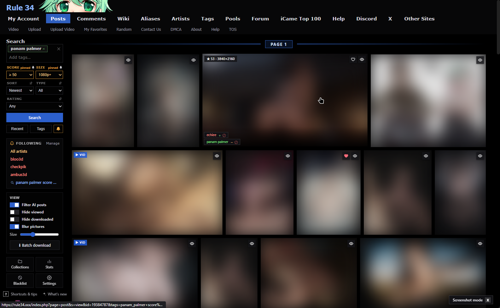
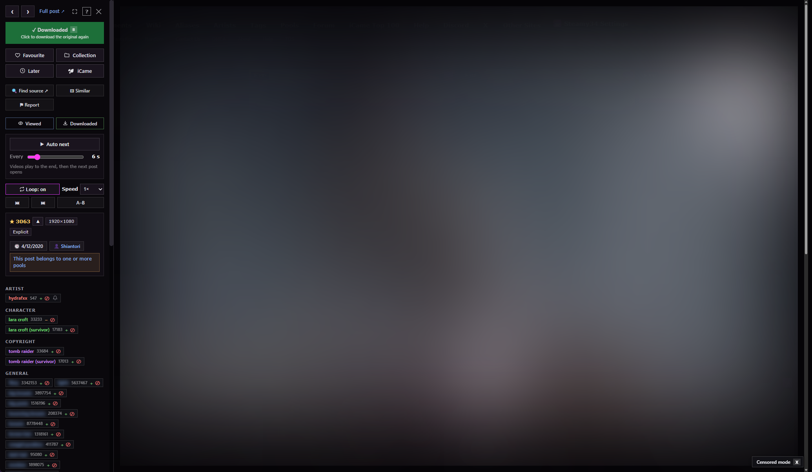
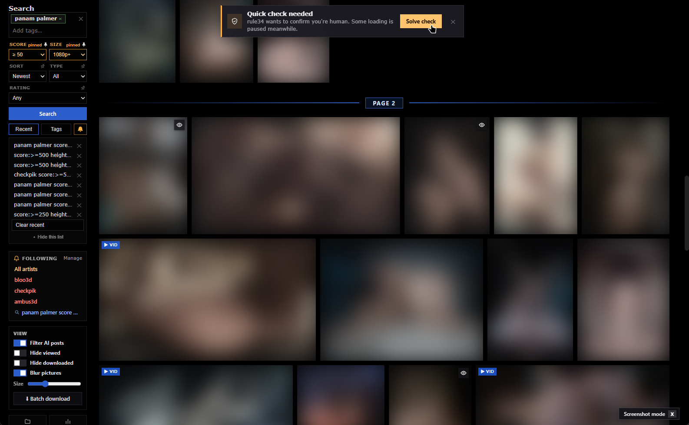
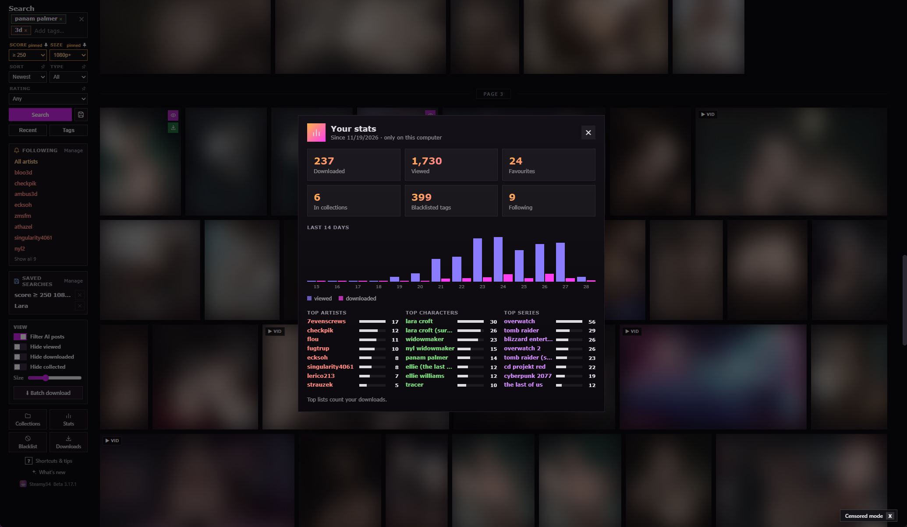

# Steamy34 – a free userscript for rule34.xxx

**Steamy34 is a free, all-in-one userscript for rule34.xxx.** It adds a dark mode (White, Dark and OLED), a popup viewer, a much easier tag search, downloads named after the post's tags, artist following and saved searches with new-post counts, and blacklists of any length. It also has a touch-friendly phone layout for Android. It runs in Tampermonkey or Violentmonkey.

By **steamycorner** · written with AI · License: CC BY-NC-SA 4.0 · Beta

> ### ⬇ Install from Sleazy Fork: [sleazyfork.org/scripts/606445-steamy34](https://sleazyfork.org/en/scripts/606445-steamy34)
> One click on **Install this script**, and Tampermonkey **keeps Steamy34 up to date by itself** from there – nothing else to do.
> This GitHub page is the **source code**, the README and the FAQ. Please install from Sleazy Fork, not from the files here.

> **A fan-made hobby project.** Steamy34 is free and will never be monetized: no ads, no paid features, no data collection. It isn't made by or connected to rule34.xxx.

> **About the code.** Steamy34 is designed by steamycorner, a designer (web design, corporate identity, 3D) rather than a programmer. The code is written with AI (Claude), and bug fixes are made the same way, so mistakes are possible. Each version is tested before release. Problems can be reported on Discord or in the Feedback tab.

Questions, bugs or ideas: join the **Steamy34 channels (#feedback, #new-ideas) on the [steamycorner Discord](https://discord.gg/Udg9sNTBHb)**, or write in the [Feedback tab on Sleazy Fork](https://sleazyfork.org/en/scripts/606445-steamy34/feedback).

---

## Screenshots

*All pictures are blurred with Steamy34's own Censored mode (press X).*

| | |
|---|---|
|  |  |
| **Posts page** – tag search with filters, Following, view switches | **Popup viewer** – download, auto next, post info and tags |
|  |  |
| **Recent searches** and infinite scroll | **Your stats** – kept only on your computer |

---

## Features

**Look**
- White, Dark and OLED (true black) colour modes for rule34.xxx, each with depth (cards, panels, shadows) – rule34's own theme follows along, so pages don't flash white while they load
- Modern thumbnail layout (original ratios or square tiles) with a size slider
- VID / GIF labels and artist / character tags on the thumbnails – or clean thumbnails, with tags only on hover or in a strip below
- Square or rounded corners
- A start page that's a small home: your search, "Continue" where you left off, recent searches, favourite tags and the newest posts from who you follow
- My Account as clean tiles (rule34's pages on top, security below) and Options in tidy groups, with the API field folded away

**Viewing posts**
- Popup viewer: posts open on top of the list, no new tabs
- Browse with ← / → or A / D, close with Esc or a middle click – at the end of the list the next page loads by itself
- Comments (all of them – "More comments" loads the rest), votes, favourites, post info and parent / child / pool links inside the popup
- ♥ favourites both ways: on thumbnails and in the popup, ♥ again removes a favourite (with Undo) – also right on your favourites page
- Slideshow ("Auto next") with a timer, theater mode, click-to-zoom
- Hover previews: videos play and score / resolution show when you hover a thumbnail
- Post pages: a click on the picture shows it at its real size (or turn "Fit pictures to the screen" off); long comic strips fit the width and read from the top

**Search**
- Tags as bubbles: add, remove or exclude a tag with one click
- Filter menus for score, size, sort, type and rating
- Pinned filters that stay on for every new search
- Recent searches and favourite tags, one click away – small menus next to the sidebar (on phones: a sheet from the bottom)

**Follow artists & save searches**
- Click the bell next to an artist in a post to follow them
- The sidebar lists everyone you follow, each with a count of their new posts
- **Following window** (click one, or press G): your artists as a row of circles – a coloured ring means new posts – and their newest posts in a grid, with NEW on the ones since your last visit, each post in its own shape. It opens on top of the page you're on – "Bigger" makes it nearly full screen
- Click a post to open it in the popup: ← / → go through that artist's posts and load more at the end. "All" mixes every followed artist
- Always newest first – "Open as a search" takes you to the normal search with every filter and sort
- **Saved searches:** the disk button next to Search saves a search with all its filters. They sit under Following in the sidebar, each with its new posts – a click opens that search, with NEW on what's new
- The browser tab shows "(12) rule34" while there are new posts; L in the popup follows the artist

**Downloads**
- Press **B** on a post to download the original in full resolution (the key can be changed) – or the ⬇ on a thumbnail, without opening the post
- Files are named after the tags: `[character] [series] [artist] #post.jpg` – or the classic `Character_Series_Artist_Resolution` style
- Optional own download folder (Chrome, Edge, Brave)
- Batch downloads of ticked posts or whole collections, with Pause / Cancel
- Asks before downloading a post a second time

**Blacklist**
- One Blacklist panel – in the sidebar and on rule34's Options page – with tag types, sorting, a filter and your recent tags
- ⊘ next to any tag blacklists it; posts already on screen are greyed out, with Undo
- **As long as you like:** rule34 keeps the blacklist in one browser cookie of about 4,000 characters, so longer lists get lost. Steamy34 keeps the whole list and hides the rest itself, everywhere
- Your account keeps a copy: tags not on it yet are marked, and Save on Options puts the list there
- **Blocked stays blocked:** Steamy34 checks every post against your whole blacklist itself – on every list, while scrolling, in the popup and the Following window. A blacklisted post you open anyway (a link, a post page) is covered, with "Show anyway" if you really want to see it
- **Mute for a while:** hide a tag for 24 hours or 7 days – it comes back by itself
- **Blur instead of hide**, per tag: its posts show blurred with the tag named and a Show button (any other blacklisted tag still hides the post)

**Organising**
- Download and viewed buttons on the thumbnails: green = downloaded, blue = viewed. Hover the eye to mark a post as viewed – or as downloaded without downloading it. Every thumbnail item (♥, download, viewed, marks, tags) has its own switch
- Hides viewed or downloaded posts if you like
- Collections (your own folders of posts) – **optionally on all your devices**: their posts are favourited too, so they're on your phone, and your favourites page becomes "Favourites & Collections". Un-favourite a post anywhere and it leaves its collections
- Collection tools: pick a cover, sort the posts or drag them into your own order, add a note
- Your favourites page: mark all as viewed or downloaded, or select posts to download, put into a collection or unfavourite in one go
- A Downloads window with every post you downloaded, newest first
- Stats: your top artists, characters and series

**Phone (Android)**
- Picture on top in the popup, info and comments below
- Swipe left / right to browse, swipe down or press Back to close
- One ☰ Menu with all of Steamy34's tools (Collections, Stats, Blacklist, Downloads, Settings)
- Thumbnail size of their own on phones (the Size slider in the menu changes it)
- The Following window fills the screen; Back closes it

**More**
- Infinite scrolling with "Page N" dividers – and "Continue at page N" when you come back to a search
- "Copy info for a bug report" in Settings → Help
- With an ad blocker on, no empty ad spaces next to or above the posts – without one, every ad stays exactly as rule34 shows it
- Gentle on the site: background page loads wait in one line and are spaced out, so Cloudflare checks come much less often. When one does come, a clear, pulsing notice at the bottom of the screen asks you to solve it (the *?* explains why: without it rule34 loads nothing new). The check window also points to the optional API key, which makes checks rarer
- Steamy34 Settings in rule34's top menu, on every page
- A welcome guide with every feature in chapters (Computer and Phone), a keyboard map of all keys and drawings of every touch gesture – plus a quick tips window
- Censored mode (X): blurs every picture, video and comment – safe for screenshots or in public
- Settings with a search box
- Backup and restore of all settings and data
- **Optional: your rule34 API key** (Settings → API key). With it, new-post counts and hover previews use rule34's API – plain data instead of whole pages, so fewer Cloudflare checks. The key only goes to rule34's own API, stays in this browser and is never in a backup. Without it, everything works the same

---

## Install

1. Install a userscript manager: **Tampermonkey** or **Violentmonkey** (Chrome, Firefox, Edge, Brave and others).
2. Open the [Steamy34 page on Sleazy Fork](https://sleazyfork.org/en/scripts/606445-steamy34) and click **Install this script**.
3. Open rule34.xxx. The welcome guide shows everything, including all keys and touch gestures.

**Updates:** automatic. Tampermonkey checks Sleazy Fork for new versions and installs them for you – your settings, history and followed artists always stay. (`Steamy34.user.js` in this repository is the file Sleazy Fork takes its updates from; you don't need to download it.)

**On Android:** install **Firefox** from the Play Store, add **Tampermonkey** (Firefox ⋮ → Extensions), then install Steamy34. It switches to its phone layout by itself.

---

## Keyboard shortcuts (in the popup viewer)

| Key | What it does |
|---|---|
| ← / → (or A / D) | Previous / next post |
| B | Download the original, named after its tags |
| F | Add to your rule34 favourites (again: remove it) |
| C | Add to one of your collections |
| T | Theater mode (only the picture) |
| W / S | Scroll to the comments and back (when A / D browsing is on) |
| Esc or middle click | Close the post |
| L | Follow (or unfollow) the post's artist |
| X | Censored mode: blur every picture, video and comment (anywhere, not just the popup) |
| G | Open / close the Following window (anywhere; ← / → switch artists there) |

All keys can be changed in *Settings → Viewing posts*, *Settings → Following* and *Settings → Downloads*.

---

## FAQ

### What's the Cloudflare check – and what do I do?
rule34.xxx is protected by Cloudflare, which now and then asks you to confirm you're a person. With Steamy34 a **pulsing notice appears at the bottom of the screen**: click **Solve**, tick the box, and everything carries on. **Until it's solved, rule34 loads nothing new** – no new pages, previews or post info – so it's worth doing right away. Steamy34 pauses its own loading meanwhile and spaces out its page loads, so checks come up much less often; an optional API key (Settings → API key) makes them rarer still.

### Is Steamy34 safe?
Here's what you can check yourself, without having to trust anyone:
- **It can only talk to rule34.xxx.** The script header allows connections to `rule34.xxx` and its subdomains – nothing else. Tampermonkey enforces that and shows it on the install screen.
- **It only runs on rule34.xxx**, nowhere else in your browser.
- **The code is readable and public** – here on GitHub and under "Code" on Sleazy Fork. Nothing is scrambled (Sleazy Fork doesn't allow that).
- **Nothing is collected.** There's no server behind Steamy34; everything it remembers stays in your browser (Settings → Privacy & data shows all of it).
- **It's written with AI help** by a designer, not a programmer – said openly, and every version is tested before release.

Unsure about something? Ask in the [Discord](https://discord.gg/Udg9sNTBHb) or the Feedback tab.

### Does Steamy34 work across my devices?
It works best on **one device**. Each browser keeps its own Steamy34 data – viewed / downloaded marks, followed artists, saved searches, collections, settings and the full blacklist – and nothing syncs by itself. What does carry over:
- **Favourites** – they're on your rule34 account anyway (and with "Collections on all your devices", collection posts too).
- **The blacklist** – Options → *Save to account* on one device; opening Options on the other takes the tags over.
- **Everything else** – Settings → Privacy & data → *Export backup*, then *Import backup* on the other device. Importing **combines**: nothing is removed and each device keeps its own settings, so you can go back and forth to keep both in step.

### What is Steamy34?
A free userscript that upgrades rule34.xxx: dark mode, popup viewer, easier tag search, tag-named downloads, artist following and a phone layout. It runs in your browser through Tampermonkey or Violentmonkey.

### Is there a dark mode for rule34.xxx?
Yes. Steamy34 has three colour modes: White, Dark and OLED (true black). Pick one in the sidebar, in the welcome guide or in Settings → Look & feel.

### Can I blacklist more tags than rule34 allows?
Yes. rule34 keeps your blacklist in a single browser cookie, which holds about 4,000 characters – tags beyond that are silently lost in the browser. Steamy34 keeps the whole list and hides the rest itself. Open My Account → Options once and it takes over every tag on your account.

### What does the API key do – and is it safe?
It's optional. rule34's API sends the same posts as plain data instead of whole web pages. If you paste your key in Settings → API key, Steamy34 uses it for new-post counts and hover previews, which means far less for rule34 to send and fewer Cloudflare checks. The key is only ever sent to rule34's own API (api.rule34.xxx), stays in your browser, isn't in backups or bug reports, and "Remove key" deletes it. Steamy34 never reads it from your Options page. Not sure? Ask on the [Discord](https://discord.gg/Udg9sNTBHb).

### Videos stall or won't start. What can I do?
Try another video server: Settings → Viewing posts → *Video server* (the same as "Preferred CDN location" in rule34's Options).

### How do I download from rule34.xxx with the tags in the file name?
Install Steamy34 and press **B** on any post (or click Download in the popup). The file is saved in full resolution and named like `[character] [series] [artist] #12345.jpg`. You can switch to the classic `Character_Series_Artist_Resolution` style in Settings → Downloads.

### Can I download many rule34 posts at once?
Yes. Use "Batch download" in the sidebar, tick the posts you want (or "Select all new") and start. A panel shows the progress with Pause and Cancel. You can also download a whole collection.

### Can I save rule34 downloads to a specific folder?
Yes, in Chrome, Edge and Brave: Settings → Downloads → *Choose folder…*. In Brave, first turn on `brave://flags/#file-system-access-api`. Firefox and phones save to the normal Downloads folder.

### How do I follow an artist on rule34.xxx and see their new posts?
Open a post and click the bell next to the artist's name. The artist then appears in the sidebar under "Following", with a count of their new posts. Click the artist (or press G) to see their newest posts in the Following window – the ones since your last visit are marked NEW.

### Is there a popup viewer for rule34.xxx?
Yes. With Steamy34, every post opens in a large viewer on top of the list, with tags, comments, votes and favourites. Browse with the arrow keys (or A / D), close with Esc or a middle click.

### Does Steamy34 work on phones?
Yes, on Android with Firefox and Tampermonkey. It uses a touch-friendly layout: swipe to browse, swipe down or press Back to close a post, and one ☰ Menu for all tools. Steamy34 is made and tested for Android; iPhones and iPads aren't tested.

### Does Steamy34 collect any data?
No. It only talks to rule34.xxx itself. Everything it remembers (settings, searches, collections, viewed and downloaded posts, followed artists, your blacklist) stays in your browser. Settings → Privacy & data shows all of it and lets you delete it.

### Do I need a rule34.xxx account?
No. Only favourites, voting and comments need a rule34.xxx login. Everything else works without one.

### Is Steamy34 free? Is it official?
It's free and will never be monetized. It's a fan-made hobby project by steamycorner, not made by or connected to rule34.xxx.

### Can I use my Steamy34 collections on my phone too?
Yes, if you turn on "Collections on all your devices" (you're asked once when you open Collections, or Settings → Downloads). Steamy34 then also favourites every post you put into a collection – rule34 keeps favourites on your account, so they show up on your phone on the favourites page ("Favourites & Collections"). The folder names stay on the device that made them. It needs a rule34.xxx login.

### Can I move my settings to another browser or my phone?
Yes. Settings → Privacy & data → *Export backup* saves everything to a file; *Import backup* on the other device **combines** it with what's there – nothing is removed, and you choose whether the settings come along too.

### Which browsers are supported?
Any browser with Tampermonkey or Violentmonkey: Chrome, Firefox, Edge, Brave, Waterfox, Opera and others. On Android: Firefox.

### How do I install and update Steamy34?
Install it from its [Sleazy Fork page](https://sleazyfork.org/en/scripts/606445-steamy34) with one click. Updates come automatically: Tampermonkey checks Sleazy Fork regularly (or right away via Tampermonkey → Utilities → "Check for userscript updates"). Your settings and data are kept with every update.

### Something doesn't work. Where do I report it?
Post it in #feedback on the [steamycorner Discord](https://discord.gg/Udg9sNTBHb) or in the Feedback tab on the Sleazy Fork page. A short description of what you did and what happened helps most.

---

## License

[CC BY-NC-SA 4.0](https://creativecommons.org/licenses/by-nc-sa/4.0/): you may share and change Steamy34 – as long as you **credit steamycorner** (with a link to the original), **don't use it commercially** (no selling, no paywalls, no ads) and **share changed versions under the same license**. See [LICENSE](LICENSE).

*(Versions up to Beta 3.4 were released under CC0 1.0.)*
